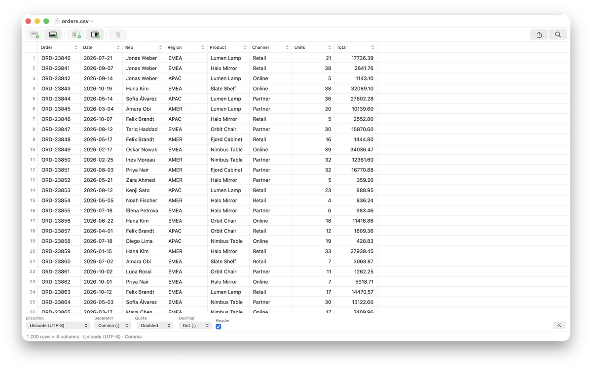
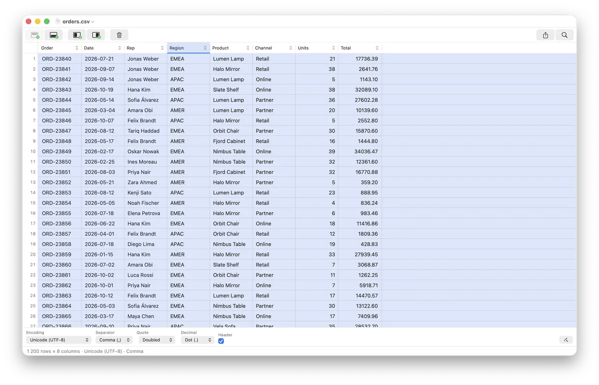
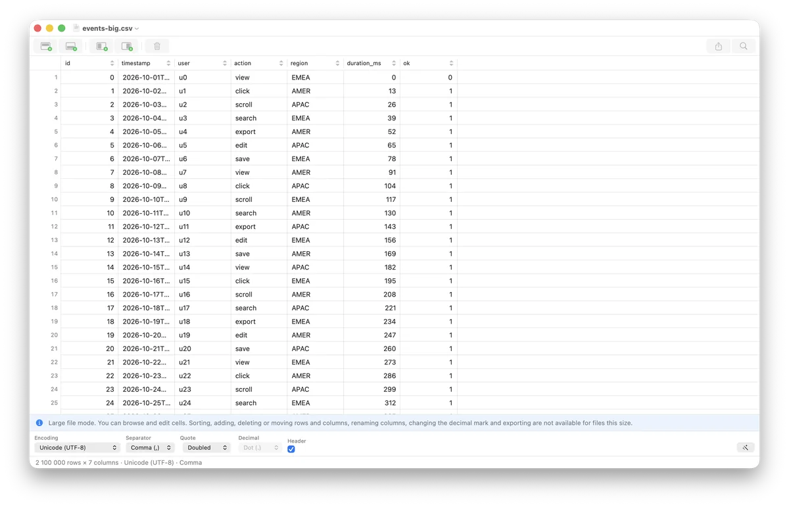
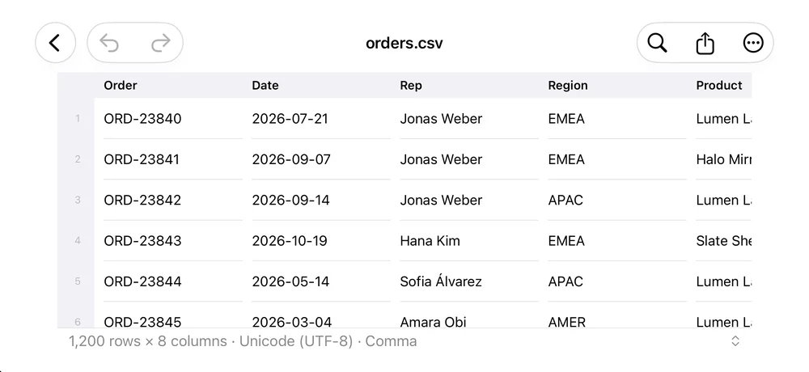

<p align="center">
  
</p>

# TabTool

A modern, independent CSV editor for macOS and iOS in Swift. The app opens CSV/TSV/text files, detects the format automatically, lets you edit the table, and saves/exports data in the selected encoding and with the selected delimiter.

TabTool 1.0 is free on the App Store for macOS 14+ and iOS 17+. One listing (universal purchase) covers the Mac, iPhone, and iPad. The bundle ID is `app.shurco.tabtool`.

<p>
  <a href="https://apps.apple.com/app/tabtool-csv-editor/id6827919069?platform=mac"></a>
  <a href="https://apps.apple.com/app/tabtool-csv-editor/id6827919069"></a>
</p>

- Mac App Store: <https://apps.apple.com/app/tabtool-csv-editor/id6827919069?platform=mac>
- App Store (iPhone and iPad): <https://apps.apple.com/app/tabtool-csv-editor/id6827919069>

If TabTool saves you time, a rating on the App Store helps other people find it:
<https://apps.apple.com/app/id6827919069?action=write-review>. It takes a minute,
and it is the signal the store uses to show the app to more people.

## Screenshots

| Grid | Columns |
| --- | --- |
|  |  |

| Large file mode | iOS |
| --- | --- |
|  |  |

## Features

- Automatic detection of encoding, delimiter, quotes, escape character, decimal mark, and a first header row.
- Opening files by dropping them on the Dock icon, the app icon in Finder, or an open window (`.csv`, `.tsv`, `.txt`, `.tab`, `.dat`).
- Editing cells, adding and removing rows and columns (also from the right-click menus on a row or a column header), reordering rows with drag & drop and columns by dragging the header, sorting rows by a column (click the arrow in the column header, the header menu, or the Table menu), renaming a column (double-click its title, the header menu, or the Table menu; without a header it turns Header on and keeps all rows), and moving the selected rows or columns one step with `⌥⌘` arrows.
- Copying and pasting rows/columns as TSV, undo/redo for cells, structure, paste, and format changes.
- Large file mode (files of 100 MiB and more by default; the threshold is a setting): the file is memory-mapped and indexed in the background, so rows appear at once and a 5 GB file with 77.7 million rows is fully indexed about 2.7 seconds after launch, using under 100 MB of memory. You can browse, jump with `⌘↑`/`⌘↓`, and edit cells with undo; structural commands, sorting, export, Duplicate and the decimal mark are unavailable. Save and Save As stream the file (only edited rows are rewritten; the 5 GB file saves in about 6 seconds with the status bar showing progress and a Cancel button); the file is never autosaved, and closing the window or quitting with unsaved edits asks Save / Don't Save / Cancel. Saving needs free disk space of about twice the file size. Supported encodings, the row-break and quoting rules, and what is unavailable are listed in [docs/csv-format.md](docs/csv-format.md#large-file-mode).
- Saving and exporting with a different delimiter, encoding, quotes, decimal mark, and header.
- CSV, TSV, and plain text formats; UTF-8/16/32, MacRoman, Windows Latin 1/2, GBK, ISO Latin 2, Cyrillic, Greek, Turkish, Japanese encodings.
- Settings window (`⌘,`): interface language, defaults for new documents, grid appearance, large file threshold, format bar. See [Settings](#settings).
- Interface in 11 languages, chosen in Settings or following the system. See [Languages](#languages).
- No formulas, styles, or charts — this is a simple CSV editor.
- App Store: sandbox, no network, analytics, or third-party SDKs.

## iOS editor

The iOS app opens with a Documents screen and then a touch-first editor on iPhone and iPad:

- Documents lists the CSV, TSV, and text files in the app's own folder, newest first. The plus menu creates a new document (Untitled, Untitled 2, …) or imports a file; a swipe deletes with confirmation, and the context menu renames.
- The editor saves by itself: 0.8 s after a change, when leaving the editor, and when the app goes to the background. A save blocked by the encoding or quote rules is explained by the banner above the status line.

- The first tap selects a cell and its row; a second tap on the selected cell opens the editor. The editor bar above the keyboard has Previous Cell, Next Cell, and Done.
- A contextual action bar appears above the status line while a row or a column is selected. A selected row offers Add Row Above, Add Row Below, and Delete; a selected column offers Add Column Left, Add Column Right, Delete, Sort Ascending, Sort Descending, Remove Sort, and Rename. The bar is hidden without a selection and in large file mode.
- Filters live in a sheet opened from the toolbar: each criterion is a card with an enable switch, a column, an operator, and a value; Clear and Apply sit at the bottom. Closing the sheet keeps the draft criteria and the applied filter.
- Format lives in a sheet opened from the status line or the overflow menu: encoding, separator, quote, decimal mark, first row as header, and Detect Automatically. The decimal mark is unavailable in large file mode. Changing the format re-reads the file and asks before discarding unsaved edits.
- The toolbar has Undo and Redo on the leading edge (after Save and Save As in large file mode); the trailing edge has a filter button with the number of applied criteria, export, and an overflow menu with Format, Settings, About, and Save As in large file mode.
- Settings is a sheet with one form and five sections: General, New Document, Grid, Large Files, and About. Show Format Bar is not offered because the status line is always visible.
- About shows the version, what the app does, the website [tabtool.shurco.app](https://tabtool.shurco.app), Rate TabTool, Share TabTool, and the MIT license notice; the text is translated into all eleven interface languages.
- The app asks for an App Store review only after seven days, three active days, and five edits, saves, exports, or opened files; it asks once per version and at most once every 90 days. The prompt is the system StoreKit sheet; there is no pre-prompt or sentiment gate.
- Grid rows are touch-sized: Compact 32 pt, Default 44 pt, Comfortable 56 pt, against Compact 20 pt, Default 24 pt, Comfortable 32 pt on macOS. Cell text scales with Dynamic Type, capped by the row height.

### iPhone Duo

TabTool runs on both iPhone Duo displays and follows the system pose rules:

- It builds against the iOS 27.2 SDK, so the app fills the inner display and the system moves the NavigationStack toolbar and its items to a vertical bar on the side. Horizontal bars return only on the inner display in portrait.
- The editor is sized from the space it is given, not from a device or orientation check. Closing the device, opening it, rotating it, or putting it in Split View resizes the same screen and keeps the open document, its selection, and unsaved edits.
- The grid, status line, and selection action bar stay inside the safe area, including the asymmetric inset a vertical bar adds on one edge.
- When a partially folded inner display reports an active division region down the middle, the selection action bar keeps its buttons on either side of the fold instead of putting one in the curve.
- The iOS smoke test in `TabToolIOSUITests` runs on the iPhone Duo simulator. See [docs/iphone-duo.md](docs/iphone-duo.md) for the pose checklist and the App Store steps.

## Settings

On macOS, `TabTool > Settings…` (`⌘,`) opens one window with four tabs: General, New Document, Grid, and Large Files. The window fits the selected tab and reopens on the tab used last. Every change is stored at once in the app's own `UserDefaults`. The format bar and grid settings update open windows immediately; the New Document settings affect the next new document, the large file threshold the next opened file, and the language the next launch. A stored value that is not one of the offered options falls back to the default.

On iOS, Settings is a sheet opened from the gear on the Documents screen or from the document's overflow menu: one form with sections for General, New Document, Grid, Large Files, and About. It writes the same defaults at once, and the row height options are the iOS ones in the table.

The interface language applies as soon as it is picked on both platforms: every window and sheet re-renders in the new language without a relaunch. The choice is also written to `AppleLanguages`, so system-provided text such as file dialogs follows the same language at the next launch.

| Tab | Setting | Key | Default |
| --- | --- | --- | --- |
| General | Language | `appLanguage` | System |
| General | Show Format Bar (also `View > Show Format Bar`) | `showFormatBar` | on |
| New Document | Encoding | `newDocumentEncoding` | UTF-8 |
| New Document | Separator | `newDocumentSeparator` | Comma |
| New Document | Quote | `newDocumentQuoteStyle` | Doubled |
| New Document | Decimal Mark | `newDocumentDecimalMark` | Dot (.) |
| New Document | First Row as Header | `newDocumentFirstRowAsHeader` | off |
| Grid | Alternating Row Colors | `gridAlternatingRows` | on |
| Grid | Row Height: macOS Compact 20 pt, Default 24 pt, Comfortable 32 pt; iOS Compact 32 pt, Default 44 pt, Comfortable 56 pt | `gridRowHeight` | Default (macOS 24 pt, iOS 44 pt) |
| Large Files | Large File Threshold: 25, 50, 100, 250, 500, or 1024 MiB | `largeFileThresholdMiB` | 100 MiB |

- The New Document settings apply only to new documents. A file you open keeps the format detected from its content, and the format bar still changes the format of an open document.
- Files at or above the large file threshold open in large file mode.

## Languages

The interface is available in English (`en`), Français (`fr`), Español (`es`), Deutsch (`de`), Italiano (`it`), Polski (`pl`), Беларуская (`be`), Українська (`uk`), 简体中文 (`zh-Hans`), 日本語 (`ja`), and 한국어 (`ko`). Settings > General > Language lists them by their own names, plus System, which follows the macOS language and is the default.

- The choice is stored in `appLanguage` and mirrored to `AppleLanguages` in the app's own defaults domain (`[code]` for a language, the key removed for System). It applies after a restart because menus and panels resolve their strings at launch; the window shows "Takes effect after restart."
- The language list is `AppLanguage` and `CFBundleLocalizations` in `Info.plist`; a unit test keeps them equal. The translations are in `app/apple/Shared/Localizable.xcstrings`; a unit test checks that every key is translated into every language and keeps its format specifiers.
- The 10 translations are machine-generated and have not been reviewed by native speakers.
- Not localized: the strings in `Info.plist` (for example document type names). macOS itself has no Belarusian localization, so system-provided items stay English when Belarusian is chosen.

## Requirements

- macOS 14 or later.
- iOS 17 or later.
- Xcode 27.1 / Swift 6.4.
- [XcodeGen](https://github.com/yonaskolb/XcodeGen) 2.46 (`brew install xcodegen`).
- Python 3 — only for the version script.

## Repository structure

The repository follows these conventions:

- `app/apple` — the macOS and iOS app: XcodeGen `project.yml`, the `TabToolKit` package, the `Shared` shell, platform files `macOS/` and `iOS/`.
- `app/apple/TabToolKit` — CSV core: parser, writer, format heuristics, table model, clipboard, export. No AppKit/SwiftUI.
- `app/apple/Shared` — SwiftUI shell, document, the macOS grid on `NSTableView`, format controls, filters, export, Settings and preferences (`Settings/`), resources.
- `app/apple/macOS` — the macOS platform files: `App` (Info.plist, entitlements, privacy manifest), `Document`, `Format`, `Grid`.
- `app/apple/iOS` — the iOS platform files: `App`, `Library` (document list and editor host), `Document` (toolbar, format sheet, contextual action bar), `Filter` (filter sheet), `Format`, `Grid`, `Settings`.
- `app/apple/Shared/Assets.xcassets` — placeholder `AppIcon`; final branding is a release task.
- `app/apple/Shared/Localizable.xcstrings` — String Catalog for all UI text: English plus 10 machine-generated translations (see [Languages](#languages)).
- `app/apple/TabToolTests`, `app/apple/TabToolIOSTests`, and `app/apple/TabToolUITests` — app unit, iOS unit, and UI tests.
- `scripts` — `app` (XcodeGen + xcodebuild), `test`, `bench-large` (large file benchmark), `lib/version`.
- `docs` — architecture, build, App Store, CSV format.
- `web` — the promotional site: SvelteKit, prerendered static output for Cloudflare Pages (see [web/README.md](web/README.md)).
- `.superpowers/sdd` — working spec/plan artifacts, not tracked by git.
- `TabTool.xcodeproj` is generated and not committed.

## Build

From the repository root:

```sh
./scripts/app run macos
./scripts/app build macos
./scripts/app archive macos
./scripts/app build macos --bump-version --upload
./scripts/app build ios --bump-version --upload
./scripts/app run ios
./scripts/app build ios
```

`run macos` builds and opens the app. `build macos` and `archive macos` build without signing (`CODE_SIGNING_ALLOWED=NO`); the archive is an unsigned verification build, not an upload-ready App Store archive. `build macos --upload` and `build ios --upload` instead sign a Release archive (automatic signing; `APPLE_TEAM_ID=...` is read from the gitignored `.env` in the repo root or the environment; needs a signed-in Xcode account) and exports it with `destination=upload` straight to App Store Connect. `run ios` boots the first available iPhone simulator, installs, and opens the app; `build ios` builds for the iOS Simulator. The script calls `xcodegen generate` itself.

Without the script:

```sh
cd app/apple
xcodegen generate
xcodebuild -project TabTool.xcodeproj -scheme TabTool \
  -destination 'platform=macOS' build
```

## Tests

```sh
cd app/apple/TabToolKit && swift test
./scripts/test
./scripts/app test ios
./scripts/test --ui
```

`./scripts/test` runs the core package and the macOS app unit tests. `./scripts/app test ios` runs the iOS unit tests. `./scripts/test --ui` adds the XCUITest smoke suite; it needs the macOS automation permission for the test runner (or run it from Xcode). Current coverage is 254 core Swift Testing tests plus the opt-in large file benchmark and 10 performance tests, 320 app unit tests, 19 UI tests, and 196 iOS unit tests. `./scripts/bench-large [GiB]` runs the large file benchmark (see Performance). Details are in [docs/building.md](docs/building.md).

## Performance

Core operations were measured in release mode on synthetic CSVs (numeric and text columns, quoted multiline fields): 100k rows x 20 columns (20 MB), 500k x 10 (44 MB), and 5k x 200 (10 MB). The generator is `makeBenchmarkCSV` in the core test support; the performance tests in `CSVPerformanceTests` use smaller sizes so the debug run stays fast. Times in ms, before -> after:

| Operation | 100k x 20 | 500k x 10 | 5k x 200 |
| --- | --- | --- | --- |
| Format detection | 388 -> 39 | 836 -> 89 | 204 -> 19 |
| Write / non-UTF-8 save validation | 543 -> 152 | 1279 -> 268 | 282 -> 78 |
| Unquoted save validation (per edit) | 15* -> 1 | 793 -> 49 | 1 -> 0 |
| Convert decimal mark | 837 -> 354 | 2046 -> 868 | 432 -> 189 |
| Sort, numeric column | 94 -> 59 | 489 -> 309 | 4.5 -> 2.7 |
| Sort, text column | 384 -> 293 | 2239 -> 1793 | 15 -> 12 |

\* Stopped early at the first ambiguous cell; the full scan is the 500k figure.

Measured and left alone (already cheap or inherent): parsing (186 ms / 435 ms / 84 ms), building the table (20 / 83 / 4 ms), row reorder, move and delete (10-60 ms, linear), table equality (identical buffers return at once, 1.4 ms for distinct equal buffers), undo snapshots (copy-on-write; a cell edit copies one column, about 1 ms at 500k rows), and the grid (a cell edit refreshes only visible cells and never reloads the table; header sort arrows repaint only on change). Text sorting is bound by `localizedStandardCompare`.

### Large files

`./scripts/bench-large 5` (release build, Apple M4 Pro, 24 GB, APFS SSD, file in the page cache) on a generated 5.00 GiB CSV with 68.2 million rows x 8 columns (quoted text, a multiline field every 1000 rows). Footprint is the process's physical footprint, the number Activity Monitor shows; the benchmark process starts at 15 MiB.

| Metric | Value |
| --- | --- |
| Open to the first 64 rows (map, detect format, index the first 8 MiB, decode) | 45 ms |
| Full index | 1.97 s (2.7 GB/s) |
| Footprint after indexing | 43 MiB |
| Jump to a random row (1000 reads) | p50 0.06 ms, p99 1.2 ms |
| Scroll 100k rows x 8 cells | 179 ms, block cache hit rate 99.8% |
| Save, no edits / 1 edit / 1000 edits | 3.8 s / 4.8 s / 6.2 s; peak footprint 46 / 46 / 36 MiB |

In the Release app (sandboxed) with a 5.0 GiB file of 77.7 million rows: rows on screen and indexing under way 0.9 s after launch, fully indexed at 2.7 s, footprint 91 MB after indexing with no accessibility client; Save with one edit takes 6.3 s including indexing the written file, footprint up to 114 MB. Saves are disk-bound; cold-cache times were not measured.

Known limits: an accessibility client (VoiceOver, automation tools) reading the rows on screen near the end of a huge file makes AppKit allocate 8 bytes per row up to that row (about 620 MB at row 77.7 million). Rows near the top cost nothing.

## Documentation

- [Architecture](docs/architecture.md)
- [Build and versions](docs/building.md)
- [App Store and privacy](docs/app-store-compliance.md)
- [CSV format and editor behavior](docs/csv-format.md)

The local working spec/plan and execution log live in `.superpowers/sdd/` and are not part of git.

## Release checklist

The code is feature-complete for a 1.0 release, but the release identity is deliberately not chosen in the repository:

- [ ] Choose the signing team and check that the name TabTool and bundle ID `app.shurco.tabtool` do not conflict with an existing App Store listing.
- [ ] Replace the placeholder icon in `app/apple/Shared/Assets.xcassets/AppIcon.appiconset` with final 1024 px macOS artwork.
- [ ] Set `app/apple/version.json` (`name`, `build`) and sign with the team. Put `APPLE_TEAM_ID=...` in `.env`, then archive and upload with `./scripts/app build macos --upload` or `build ios --upload` (or Xcode Organizer); plain `./scripts/app archive macos` is an unsigned verification build.
- [ ] Inspect the archive: three document types in `Info.plist`, sandbox and user-selected read-write entitlements, `PrivacyInfo.xcprivacy` in `Contents/Resources`, and the app icon.
- [ ] Run `./scripts/test`, `./scripts/test --ui`, and the manual QA matrix in `docs/building.md`.
- [ ] Fill in App Privacy as **Data Not Collected**; confirm `ITSAppUsesNonExemptEncryption=false` with the account owner.
- [ ] Have native speakers review the machine-generated translations in `app/apple/Shared/Localizable.xcstrings`.
- [ ] Prepare screenshots, description, keywords, and reviewer notes without promising formulas, databases, or "any tables"; include the required MIT notice. For a Guideline 2.1 "Information Needed" rejection, paste the notes from [docs/app-store-compliance.md](docs/app-store-compliance.md#notes-for-review) and attach a physical-device screen recording.
- [ ] After upload, pin the uploaded build in `app/apple/version.lock.json` and never reuse a build number.

## License

[MIT](LICENSE). The required copyright and permission notice is kept in the LICENSE file and bundled with the app. The About screen shows the same notice, and the project website is [tabtool.shurco.app](https://tabtool.shurco.app).
